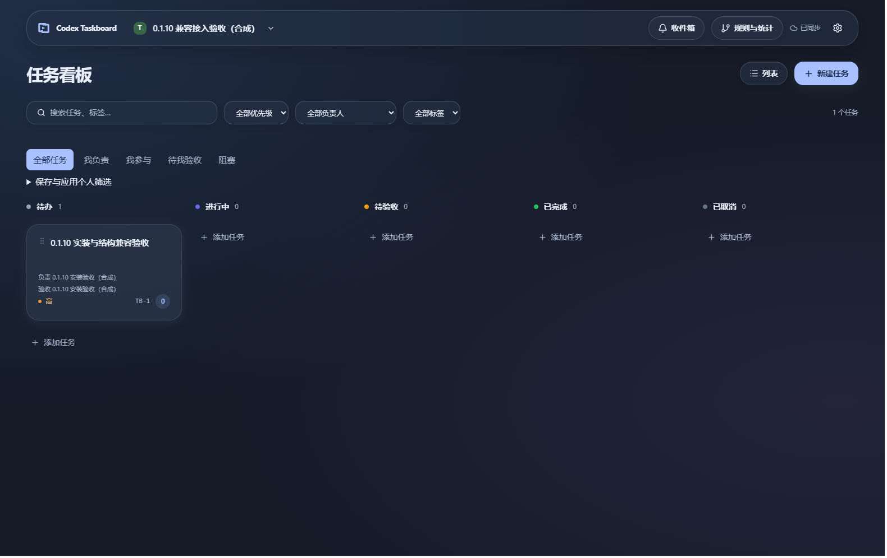

# Codex Taskboard

A task board embedded in the Codex sidebar. Share tasks, progress and human review across devices and trusted teams while keeping existing Codex projects and conversations.

[简体中文](README.md) · [Download 0.1.11](https://github.com/i-am-yimin/codex-taskboard/releases/tag/v0.1.11) · [User guide](docs/user-guide.md) · [Deployment](docs/deployment-openresty.md) · [Documentation](docs/README.md) · [Changelog](CHANGELOG.md)



## Features and status

- Account settings for avatars, display names, private contact visibility, email security, appearance and device sessions; web-only instance administration.
- Work and personal spaces, board and list views, priorities, checklists, comments and activity.
- Role-based access, one accountable owner, multiple contributors and a reviewer; subtasks, dependencies and human-confirmed proposals.
- Separate claims, real local runs, submissions and human acceptance; personal views, mentions, inbox, reminders and automation rules.
- Connect or open your normal Codex environment from Taskboard, preserving sign-in, projects and conversations.
- Switch between the board and the complete conversation workspace as peer views; selecting the board again keeps it open.
- Cached read-only browsing and local drafts, with four themes, light/dark modes and optional account appearance sync.

The Windows client is **0.1.11, an unsigned public pre-release**, paired with the independently published **0.1.5-preview.1 server**. The fixed-tag installer was installed and its payload, bundled runtime, provenance and anonymous download verified, preserving original account data. Collaboration requires protocol 1; the account center requires `accountCenter: 1` and migrations 0001–0011. Installing the client does not upgrade the server. Native account behavior and final-package evidence are recorded separately; focused Codex window restoration checks remain scheduled after publication. See the [acceptance record](docs/acceptance-0.1.11.md) for scope and limits.

Daily Codex mode uses manual task copying and sending. Agent task writes require a separate CLI login; automatic unsent draft insertion remains limited to the verified independent test environment. Full offline editing, automatic message sending, complete chat synchronization, historical conversation navigation and GitHub synchronization are not available.

## Get started

1. Obtain a reachable Taskboard HTTPS server and an account or invitation. The desktop installer does not create a hosted server or account; Taskboard and Codex have separate sign-ins.
2. Download the [Windows x64 installer](https://github.com/i-am-yimin/codex-taskboard/releases/download/v0.1.11/Codex.Taskboard_0.1.11_x64-setup.exe) and verify [SHA256SUMS](https://github.com/i-am-yimin/codex-taskboard/releases/download/v0.1.11/SHA256SUMS). It bundles its runtime; desktop users do not need system Node.js or pnpm.
3. Save the server root URL in Taskboard and sign in. Map the repository to an existing local folder, then click “连接 Codex” in the main Taskboard window. If prompted, save your work and normally exit Codex once so Taskboard can continue.
4. After connection, ordinary Taskboard startup can restore the sidebar. This preference can be disabled in Settings → Connections and devices; “打开 Codex” returns to the original window.
5. Claim a task, manually copy its requirements to the intended Codex project, review and send, then submit the result in Taskboard for human acceptance. Optional CLI automation requires a separate login and known full task IDs; follow the [CLI instructions](docs/user-guide.md#agent-cli).

The [user guide (Chinese)](docs/user-guide.md) covers upgrades, tray exit, local backups, multiple devices and troubleshooting. For new self-hosted instances, use the published Linux amd64 image with [Docker Compose and OpenResty HTTPS](docs/deployment-openresty.md). Existing Caddy deployments are documented [separately](docs/deployment.md).

## Preview and development

Requires Node.js 22.16+ and pnpm 10.28.0. To view synthetic demo data:

```sh
pnpm install --frozen-lockfile
pnpm dev:web
```

Open [the interactive demo](http://127.0.0.1:4173/?demo=1). It does not access real accounts or execute tasks. Full server setup, isolated databases and test commands are in the [development guide](docs/development.md).

Read [CONTRIBUTING.md](CONTRIBUTING.md) before making changes. Start `codex/<topic>` branches from `origin/main` and target PRs at `main`; see [repository maintenance](docs/maintenance.md) for branch cleanup and recovery. Agents use [AGENTS.md](AGENTS.md) to enter the same workflow.

| Directory | Responsibility |
| --- | --- |
| `apps/` | Web, server, local companion and Windows desktop applications |
| `packages/` | Domain contracts, Codex adapter and task CLI |
| `scripts/`, `tests/` | Build, diagnostics and verification |
| `deploy/`, `.github/` | Deployment configuration, CI and release workflows |
| `docs/` | Guides, architecture decisions and versioned acceptance records |

[Documentation index](docs/README.md) · [Architecture](docs/architecture.md) · [Decisions](docs/adr/README.md) · [Security](SECURITY.md)

Issues and fork PRs are welcome. Repository merges, tags and releases remain under @i-am-yimin's control and the existing approval process.

MIT licensed, independently implemented. Product inspiration: [dashi-taskboard](https://github.com/chuspeeism/dashi-taskboard). This community project is not an official OpenAI product.
