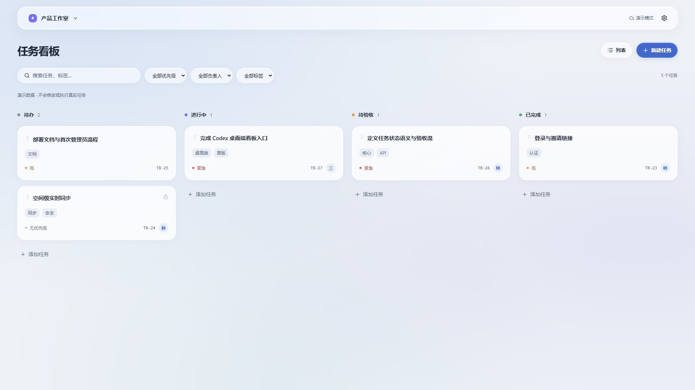

# Codex Taskboard

嵌入 Codex 侧栏的任务看板。共享待办、进度和验收，保留原有项目与聊天，适合个人多设备和可信团队协作。

[下载 0.1.7](https://github.com/i-am-yimin/codex-taskboard/releases/tag/v0.1.7) · [使用手册](docs/user-guide.md) · [服务端部署](docs/deployment-openresty.md) · [更新日志](CHANGELOG.md) · [English](README.en.md)



> 0.1.7 已发布：看板与会话作为同级页面切换，修复会话标题栏穿透与双重选中；再次点击看板保持当前页。沿用四套主题、主题包及账号外观同步，见[主题指南](docs/themes.md)。

## 产品功能

- **任务管理**：工作与个人空间、看板与列表、优先级、检查清单、评论和活动记录。
- **协作验收**：成员角色控制访问，领取任务、提交结果、人工验收，多设备同步进度。
- **日常 Codex 接入**：在 Taskboard 内连接或打开原环境，保留登录、项目与聊天，成功后可随 Taskboard 启动恢复侧栏。
- **任务执行**：日常模式手动复制需求到 Codex；随包 CLI 可另行登录后读取、领取和回写。独立测试环境保留自动草稿能力。
- **离线浏览**：查看已缓存任务、保留本机草稿，联网后再保存；支持浅色、深色和系统主题。

Windows 客户端为 **0.1.7 未签名预发布版**，日常 Codex 本轮精确验收版本为 `26.1016.8622.0`。服务端独立发布为 `0.1.3-preview.1`，提供账号主题同步，兼容原任务接口。当前不提供完整离线编辑、自动发送消息、完整聊天同步、历史会话跳转或 GitHub 自动同步。

## 使用手册

快速使用分为六步，详细操作与故障处理见[完整使用手册](docs/user-guide.md)。安装客户端不会创建云服务器或 Taskboard 账号。

### 1. 准备服务器和账号

向管理员取得 HTTPS 根地址和 Taskboard 账号，或先在浏览器接受邀请。自行使用时按下方部署服务，创建首个管理员。Taskboard 与 Codex 分别登录。

### 2. 安装并登录 Windows 客户端

下载 [Windows x64 安装包](https://github.com/i-am-yimin/codex-taskboard/releases/download/v0.1.7/Codex.Taskboard_0.1.7_x64-setup.exe)并核对[校验和](https://github.com/i-am-yimin/codex-taskboard/releases/download/v0.1.7/SHA256SUMS)。安装后打开 **Codex Taskboard**，填写 HTTPS 根地址并点“保存服务器”，再点“登录并继续”。看到“已同步”后再修改任务，无需另装 Node.js、pnpm 或 Codex CLI。

### 3. 连接本机项目与 Codex

在“设置 → 连接与设备”保存已有项目的仓库映射，再从主界面点击 **“连接 Codex”**。已运行但未启用连接时，保存工作并正常退出 Codex 一次，Taskboard 等待后自动继续。看到 Codex 侧栏的“任务看板”即接入成功，无需专用快捷方式。

首次成功后普通启动 Taskboard 可恢复侧栏；设置中可关闭自动连接。主界面的 **“打开 Codex”** 可返回原窗口。

### 4. 配置 Agent 的任务读写

这是可选步骤。看板与 CLI 独立登录；需要 Agent 自动领取或回写时，按[手册的 Agent CLI 说明](docs/user-guide.md#agent-cli)配置随包 CLI，并确认完整任务 UUID。只做手动执行和验收可跳过。

### 5. 从任务到完成

新建并保存需求与验收条件 → 领取 → 手动复制需求到正确的 Codex 项目并确认发送 → 回看板提交完成说明与验证记录 → 人工“验收并完成”。日常模式不会自动填写草稿，“在 Codex 中打开”不会自动领取或发送消息。

### 6. 多设备、退出与升级

各设备登录同一服务器，分别保存本机项目映射。关闭窗口只会收至托盘；彻底退出使用托盘菜单。升级前保存工作、退出 Taskboard 并备份本机数据，已启用连接的日常 Codex 可保持打开。离线、更换服务器及备份细节见[完整使用手册](docs/user-guide.md)。

## 部署服务端

推荐 **Linux amd64 + Docker Compose + OpenResty HTTPS**。以下在 Linux Bash 的新目录中使用已发布镜像，无需在服务器编译代码：

```bash
mkdir taskboard-server
cd taskboard-server
curl --fail --location https://raw.githubusercontent.com/i-am-yimin/codex-taskboard/vserver-0.1.3-preview.1/compose.openresty.yaml --output compose.yaml
curl --fail --location https://raw.githubusercontent.com/i-am-yimin/codex-taskboard/vserver-0.1.3-preview.1/deploy/openresty.conf --output openresty.conf
printf '%s\n' 'TASKBOARD_VERSION=server-0.1.3-preview.1' 'TASKBOARD_IMAGE=ghcr.io/i-am-yimin/codex-taskboard' 'TASKBOARD_PORT=47830' > .env
docker compose pull
docker compose up -d
docker compose logs --tail=100 app
```

把 `openresty.conf` 的 `location /` 加入同机 OpenResty 的 HTTPS 域名配置，检查并重载。打开域名，用日志中的初始化口令创建首个管理员，再把根地址交给客户端。服务仅绑定宿主机回环 `127.0.0.1:47830`，PostgreSQL 不对外发布端口。

详细配置、备份与升级见[部署文档](docs/deployment-openresty.md)。已有实例先备份数据库与密钥，旧 0.1.1 数据卷不能直接套用新的自动密钥配置；客户端升级不会自动升级服务端。

## 常见问题

| 现象 | 处理 |
| --- | --- |
| 找不到连接按钮 | 在 Windows Taskboard 主窗口操作，浏览器与内嵌看板不显示原生连接按钮 |
| 等待 Codex 退出 | 保存工作后正常退出 Codex；可取消等待，准备好再连接 |
| 已接入但设置未保存 | 检查本机存储后“重试保存”，当前连接仍可使用 |
| 草稿没有自动写入 | 日常模式手动复制需求，自动填写仅限已验证的独立测试环境 |
| 离线或 CLI 未认证 | 核对服务器、权限和独立 CLI 登录，详见[完整故障处理](docs/user-guide.md#常见问题) |

## 只预览界面与开发运行

只看合成演示可在 Node.js 22.16+、pnpm 10.28.0 环境执行：

```sh
pnpm install --frozen-lockfile
pnpm dev:web
```

打开 [交互演示](http://127.0.0.1:4173/?demo=1)，演示不连接真实账号或执行任务。

[开发指南](docs/development.md) · [开发规范](CONTRIBUTING.md) · [架构](docs/architecture.md) · [桌面技术说明](docs/desktop.md) · [安全说明](SECURITY.md) · [0.1.4 验收](docs/acceptance-0.1.4.md)

欢迎通过 Issue 和 fork PR 参与。MIT License；产品灵感来自 [dashi-taskboard](https://github.com/chuspeeism/dashi-taskboard)。本项目独立实现，是社区工具，不代表 OpenAI 官方产品。
