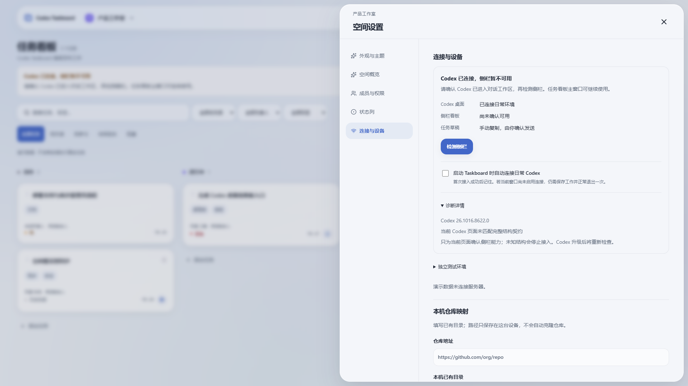
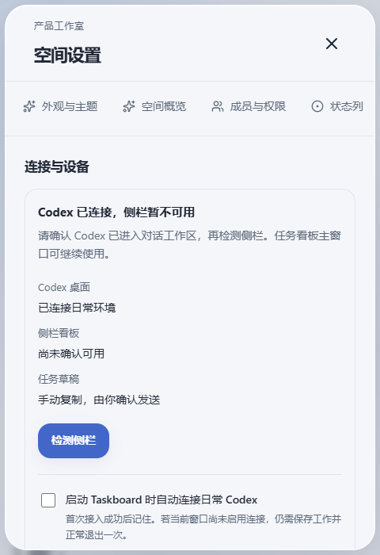

# 0.1.13 版本验收

状态：2026-11-14，接入流程改造进行中；尚未完成固定标签、最终安装和公开下载验收，不代表已发布。

## 本机问题与证据

安装版 Taskboard 0.1.12 初始显示“Codex 尚未接入”，原因是“Codex 页面未匹配完整结构契约；请等待工作区就绪或更新 Taskboard”。同一个日常 Codex 进程再次连接后，按钮恢复为“打开 Codex”，错误提示消失，没有退出或重启 Codex。

当前宿主为 OpenAI.Codex MSIX `26.1027.3384.0`。使用生产原生发现、真实进程句柄、创建时间、安装包、用户/会话、回环监听者和唯一精确页面检查完成只读复核；诊断包装器只附着已存在的日常实例，没有调用启动路径。只读结构结果匹配现有 `active-page-cache-shell-v1`：唯一根、一个 aside、两个 nav、一个当前页面、一个完整 placement/main/editor，无草稿和弹窗。没有初始报错时的同步结构快照，因此不能进一步断言原因为具体哪一种加载中间态。

本次不新增宿主契约，不按版本号放宽授权。已确认的源码问题是：原生连接与侧栏能力混为一个结果；失败提示长期保留；观察到原生正在连接时可能再次排队连接。完整原始观察保存在本机忽略目录，不进入公开源码或日志。

## 验证范围

后续记录分别列出源码检查、合成浏览器、真实宿主、最终固定安装器、随包运行时、来源证明和匿名下载。尚未执行的项目不标为通过。

已完成的合成浏览器验证：接入流程两种窗口尺寸共 42 项通过，覆盖已有连接观察、暂态结构恢复、原生成功/侧栏拒绝、明确状态对应动作、取消和超时、偏好保存失败、关键拒绝禁止启动、过期成功撤回及独立测试实例复用。它们使用隔离浏览器和本机接口替身，不代表真实 Codex 或最终安装包。

产品界面采用原生连接、侧栏、草稿能力分别呈现，明暗主题和紧凑窗口截图已经视觉审阅。缺失侧栏事实、虚假 embedded 成功及 480×700 最小窗口的补充定向 8 项通过，确认没有横向溢出且主要恢复动作可见；完整源码检查仍在收尾。

以下截图全部来自合成演示与接口替身，不包含真实账号或任务：

## 兼容与数据保护

同一有限结构契约内的版本更新无需逐个追加补丁号。未知页面结构、归属或目标变化、恢复未确认仍停止接入；不能承诺所有未来 Codex 版本的私有页面永久兼容。任务看板主窗口与本机 CLI 保留各自权限和能力边界。日常模式不自动填写或发送任务，独立环境的草稿门禁保持。

客户端与服务器独立发布，本次客户端改造不要求新增数据库迁移；生产数据库和服务器不用于验收。
