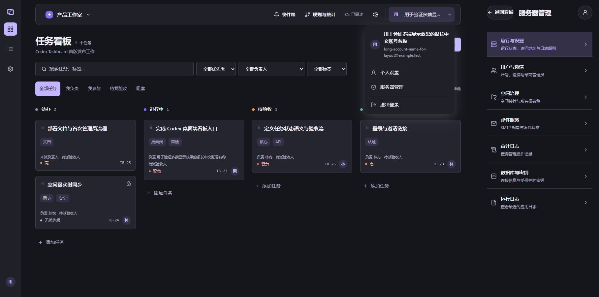

# 控制台布局验收（未发布）

本轮改动基于已发布 0.1.11 之后的 `main`，分支 `codex/console-layout`。发布标签和既有安装器保持固定；本记录覆盖源码及浏览器证据，不表示新客户端或服务器已经发布。

## 参考与改动

2026-11-02 阅读 GitHub 源码，参考其信息组织与导航方式：

| 项目         | 参考点                                 | 固定源码                                                                                                                                                           |
| ------------ | -------------------------------------- | ------------------------------------------------------------------------------------------------------------------------------------------------------------------ |
| shadcn/ui    | 身份头部、分组菜单、独立退出行         | [nav-user.tsx](<https://github.com/shadcn-ui/ui/blob/c0d63c339d6cd2fc26135590a54cf1f362269451/apps/v4/app/(app)/examples/dashboard/components/nav-user.tsx>)       |
| shadcn-admin | 等宽菜单行、右对齐弹层、资料与设置分区 | [profile-dropdown.tsx](https://github.com/satnaing/shadcn-admin/blob/e16c87f213a5ba5e45964e9b67c792105ec74d26/src/components/profile-dropdown.tsx)                 |
| Plane        | 空间入口与账号入口职责分开             | [top-navigation-root.tsx](https://github.com/makeplane/plane/blob/b98e1defb0e089d4505712d89ee9e137fd0935cd/apps/web/components/navigation/top-navigation-root.tsx) |

本项目独立实现，沿用原组件、Lucide 图标、主题变量和本机字体。

- **账号菜单**：桌面服务器链接原来继承通用按钮样式，导致居中胶囊与普通菜单行混排。现在按钮与外链共用独立行样式，身份与退出分组；异步地址读取前后保留同一个链接，避免键盘焦点丢失。
- **任务空间**：账号入口移到顶栏末端，空间工具、同步状态和身份入口有明确分隔；侧栏模式移除重复品牌。标题反映看板/列表，筛选数量紧邻标题，个人视图和低频筛选操作紧凑排列。
- **设置和后台**：统一分类图标、说明、宽度与间距。窄屏展示完整分类列表，详情提供返回和焦点衔接；返回管理分类隐藏已显示密钥。外层内容去掉通用卡片阴影。
- **异常与窄屏**：360px 顶栏保留工具，长空间名截断，主要操作目标至少 44px；筛选按可读宽度重排。错误提示与重试按钮分行，避免按钮逐字竖排。

## 验证记录

合成资料、菜单、看板、分类与表单截图保存在本机忽略目录 `.artifacts/console-layout/`。浏览器使用独立 headless Chrome；桌面入口通过受控的 Tauri/伴随服务替身验证，外部网络全部拦截，没有访问日常 Codex 或真实伴随服务。

截图矩阵覆盖四套主题的明暗模式、1440px 和 360px，包含看板、菜单、个人资料及后台分类/详情。现有响应式回归另外覆盖 480px、低高度窗口和最窄 185px 内嵌重排。布局机械扫描前后均单独记录，人工检查阅读顺序、分组、密度、长内容、键盘与错误状态。

| 检查                  | 结果与范围                                                                                                                                                                                                             |
| --------------------- | ---------------------------------------------------------------------------------------------------------------------------------------------------------------------------------------------------------------------- |
| `pnpm check`          | 通过类型、Lint、289 项测试及生产构建；65 项数据库集成测试在未提供数据库连接的默认命令中按配置跳过，不计为通过。构建仍有既有大分块及 Zod 注释提示。                                                                     |
| 最终源码类型与 Lint   | 本轮最后修改后再次通过 `pnpm typecheck`、`pnpm lint`。                                                                                                                                                                 |
| 浏览器布局 E2E        | 分组通过 15 项既有看板、响应式和主题用例，以及 4 项新增布局用例；使用本轮独立 Vite 4178 端口、独立 Chrome 和合成数据。                                                                                                 |
| PostgreSQL 与生产页面 | `scripts/test-db.ts --playwright --config playwright.account.config.ts` 的 desktop/compact 共 10 项通过：无空间用户、资料与头像、邮箱、SMTP 替身、接管到期隐私、后台密钥、旧服务器兼容、读取失败时保留输入与撤权清理。 |
| 生产离线              | `scripts/test-db.ts --offline` 通过真正断网冷重开、草稿保留、只读操作、重连及撤销会话后清理。                                                                                                                          |
| 布局检查              | 四套主题明暗 × 两种宽度的 16 组状态无页面横向溢出；机械扫描前后均无报告项，人工确认分组、长文本、焦点及主要操作可达。                                                                                                  |

本轮数据库使用独立 `.artifacts/console-layout/postgres` 和回环端口 55447，测试创建自己的 schema/数据库；没有连接生产数据库。账号 E2E 通过 `ACCOUNT_ACCEPTANCE_OUTPUT=.artifacts/console-layout/account-production` 保存证据，不覆盖 0.1.11 的历史截图。初始化页面另沿用 `.impeccable/review/`；离线截图沿用 `.artifacts/offline-*.png`。本轮开发服务、临时浏览器及测试数据库均已关闭。

## 数据与交付边界

没有 API、数据库迁移、账号权限或宿主能力变化。未保存资料保护、邮箱与密码流程、接管授权、离线限制沿用已有逻辑。没有修改生产服务器、日常 Codex、原账号或真实草稿；没有执行安装器升级，也未创建新的发布版本。
