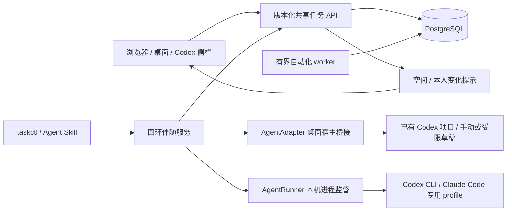

# 架构

设计约束见[架构决策索引](adr/README.md)，协作契约见[实施设计](collaborative-workflows-design.md)，运行设置见[本机 Agent 运行](agent-runners.md)。API 文档由 `/api/v1/openapi.json` 提供；处理器仍是权限与状态规则的权威。

任务看板管理目标、协作关系、成果与人工验收；Codex 桌面与独立 Agent CLI 各自管理实际会话。任务 repository 是去除凭据的仓库标识，每台设备映射到自己的已有目录。单个伴随服务对同一仓库只有一个映射，同一规范工作目录只能有一个活动运行；不自动建立 Git worktree，不提供每次运行挑选另一目录。不同账号/设备可分别映射独立目录并行处理叶子任务。

## 模块边界

`packages/core` 定义领域类型、Zod 输入、权限序、桌面 `AgentAdapter` 和独立 `AgentRunner`；不访问数据库、网络或 DOM。`apps/server` 负责当前成员权限、事务、版本、幂等、空间隔离与持久化。`apps/web` 呈现实际事实并保留草稿，不推测执行成功。`apps/companion` 保存设备状态、保护凭据、转发任务 API，并监督本实例创建的 CLI 子进程。`packages/adapter-codex` 继续负责精确宿主身份、侧栏和草稿边界；它不是 CLI 运行器。`packages/cli` 输出可判断的 JSON 与退出状态；`apps/desktop` 承担原生窗口、进程身份与打包。

服务端 `collaboration.ts` 通过明确的 `CollaborationContext` 复用 `db/taskAndRole/member/stored/saveIdempotency/rowTask/rowExecution/activity/emit`。`workflow-services.ts` 处理个人查询与通知，`automation.ts` 处理规则、区间统计及 worker，`runs.ts` 处理脱敏运行事实。`app.ts` 统一注册；本机回环运行接口不变成远程任意命令入口。

## 协作、领取与验收

任务保留一个 `assigneeId` 总负责人，增加多人职责/进度/成果、明确 `reviewerId`、父子和依赖。任务角色与当前空间权限取交集；viewer 不因被指定角色获得写权，移除/降级成员后历史关系不构成授权。AI 拆分、需求和决策先存提案，服务端记录 human/agent 来源，人类确认后原子生效；调整后的确认 payload 与原提案分别保留。

五种 semantic 仍为 todo/in_progress/in_review/done/cancelled，阻塞独立。领取只获得独占实施权，新增 execution phase `claimed`，不创建虚假 OS run。叶子独立领取和验收；父负责人在必要子任务全 done 后提交独立 integration execution，父仍需人类集成验收。checklist 保留为轻量清单。任务 PATCH 不允许跨 semantic 绕过提交/验收；取消、退回和重开使用明确命令与原因。

`task_runs` 分别保存 starting/running/cancel_requested/cancelled/succeeded/failed/unknown、权限模式与官方 session ID。真实启动、退出、取消由本机监督确认。未知不能自动恢复为成功或取消；人类核查旧进程已停止后只解除阻塞，保留 unknown 与确认人/时间/理由。成功退出也不代替提交或人工验收。

## 数据一致性与权限

账号中心与实例治理见 [ADR 0009](adr/0009-account-center.md)。`accounts.ts` 负责个人资料、头像、邮箱、密码与治理命令，`account-mail.ts` 负责加密 SMTP 与事务发件箱；`account-access.ts` 在请求上下文内复核绑定网页会话的限时接管。真实成员关系仍用于职责分配与通知接收；接管不产生永久成员资格。账号私有资料与接管内容不进入离线缓存。

PostgreSQL 是共享事实源。任务状态、职责、材料、提案和运行等版本写使用 If-Match；评论/会话关联及个人通知 ACK 使用其既有幂等约束。相同意图重试保留原键与原版本，冲突重新读取并由调用者决定合并。

API mutation、幂等响应、活动与持久通知同事务提交。任务相关写统一先锁空间行，成员变更、父子/依赖编辑、领取与父验收因此串行；循环检查同时包含父完成等待子与显式依赖，不能并发形成等待环。同空间关系由服务端校验和任务外键追溯，不宣称存在未实现的复合空间外键。唯一活动 claim 与 run 索引再防重复。

SSE 只提示变化，重连后重新获取 API 当前状态。空间流不广播私人通知正文；本人通知流提示刷新持久收件箱。浏览器 EventSource 与桌面受能力凭据保护的伴随服务 fetch 保留原认证边界。离线缓存只读；领取/共享任务变更不排队，草稿与未同步成果/运行事实明确区分。运行 outbox 保留原版本、幂等键、账号及浏览器/Agent 凭据类型，不把旧事实静默改写到新版本。登出、切账号及撤权按原策略清理缓存。

## 通知、自动化与时间统计

任务事件按当前职责和事件类型确定接收者：提交给验收人、退回给最近提交者和负责人、显式提及给选定当前成员、依赖变化给下游负责人/当前领取人；不把所有历史 execution 作者永久订阅到任务。持久通知与读/处理/稍后状态分离，静音抑制桌面提醒而不删除收件箱记录。

桌面提醒使用独立 `deliverable=true` 到期候选、设备领取和精确 deliveryToken ACK；稍后创建新轮次并使旧 token 失效。系统通知失败不等于消息丢失，弹出不等于已读。Native 通知仍取决于系统授权与实际投递结果。

自动化 worker 在 onReady 启动有界轮询、onClose 清理；按空间→规则锁顺序复验状态，唯一 occurrence 令多实例触发幂等。规则覆盖依赖就绪、dueAt 超时升级、验收等待和固定 intervalHours 周期建任务；时区用于显示，周期按绝对时长而非本地墙钟 cron，停服恢复不无限补历史。规则停用保留历史，失效管理员身份会停用，失败原因可见。

阻塞/待验收统计来自持久区间。只有任务与空间均未归档、semantic 非终态时才累计；创建 blocked 立即开区间，取消/完成/归档关闭，重开/恢复按当前事实新开区间，不把暂停期间算入等待。迁移不能复原的历史起点/失真区间标为 legacy_unknown，不计精确时长，只返回单列数量。查询按时间范围裁剪，空数据为空项，不生成示例统计。

## 扩展与证据

Codex 侧栏按 [ADR 0008](adr/0008-codex-structure-compatibility.md) 在原生身份后自检有限结构契约，版本用于诊断与独立草稿记录。结构变化只影响侧栏，任务 API、协作、通知和独立 CLI 运行器各自核验能力。合成官方 UI 原型单列[协议与宿主证据](codex-plugin-ui-probe.md)，不能将工具发现等同于原生 UI 支持。

新增持久化采用顺序迁移，保留旧任务、讨论、材料和固定发布来源；旧待验收任务缺验收人时人工补派。旧客户端的危险状态 PATCH 会被拒绝，需要协调升级。客户端候选 0.1.8 配套独立服务器候选 0.1.4-preview.1，已在授权指定实例完成部署验收，尚未公开发布，具体范围见[0.1.8 验收](acceptance-0.1.8.md)；公开 health 保留 status/database，补 serverVersion/apiVersion/capabilities/migrationRequired，仅当 0005—0009 齐全时声明协作协议 1。客户端核对明确能力而非猜测版本字符串；旧 health 缺能力时保留基础看板只读/草稿并提示升级，网络失败则单独标为未验证。web 与 taskctl 在新的共享写入/启动前重新探测，不复用缓存成功作为授权；登录/退出/本机配置与原有运行查询/取消不额外增加此门禁，原安全复核仍不变。具体任务 404 不被泛化成版本错误。GitHub 链接是成果元数据，不等于自动同步 PR 状态；GitHub 双向同步仍需单独 ADR。

源码、真实 PostgreSQL、浏览器模拟、独立真实浏览器、受控子进程、真实已登录 CLI 与最终安装包分别记录。独立 CLI 的版本/认证负路径及受控进程证据不能替代付费模型成功或实机取消/续接。当前验收进度见对应验收记录，不从架构设计推断已交付包通过。
