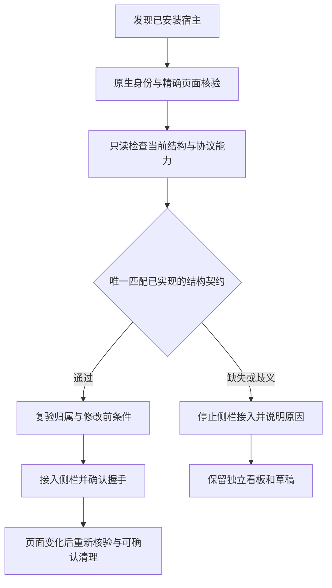

# Codex 频繁更新的兼容性改造提案

日期：2026-10-28；更新：2026-10-30。状态：已实施结构自检与独立草稿授权，固定 0.1.9 已完成授权原位安装、限定范围验收及原环境恢复；官方 global 和 thread 合成原型亦已实机通过。实装诊断方式、多个编辑器仍拒绝及配置变化限制见 [0.1.9 实装记录](acceptance-0.1.9.md)。[ADR 0008](adr/0008-codex-structure-compatibility.md) 已采纳新策略；下文保留提案背景，源码范围见[验收记录](acceptance-codex-compatibility.md)，不将未知未来版本记为已实机验证。

0.1.10 后续修复已为真实观察到的缓存页增加第五套有限契约，并保留隐藏草稿与原生复核预算；源码、隔离实机和固定 NSIS 的授权原位实装通过，当前普通环境已为 0.1.10，见 [稳定性与实装验收](acceptance-0.1.10.md)。历史配置写入来源仍未确认，本次维护前后摘要一致。

## 结论与目标

可以将维护单位从“每个四段版本号”改为“宿主结构契约”，让界面结构和能力没有变化的升级自动完成自检。不能保证任意未知未来版本的私有 DOM、CSP、页面 URL、包身份或调试协议永远不变。

推荐保留侧栏目标，近期建立自动兼容自检，长期验证官方插件 UI 路线。独立看板是故障时的数据和工作入口，不把回退到独立窗口算作侧栏接入成功。用户无需逐个补丁版本人工验收；真正发生结构或协议变化时，由维护者更新相应适配和回归。

## 当前报错来自哪里

- `packages/adapter-codex/src/index.ts` 的精确版本列表停在 `26.1016.8622.0`。标记选择、能力探测与隔离环境草稿各有版本条件。
- `apps/companion/src/main.ts` 在创建适配器前按列表拒绝未知版本，并生成“尚未完成侧栏兼容验证”的提示。该提示证明版本未在清单中，不证明已经观察到新版本页面不兼容。
- `apps/desktop/src-tauri/src/managed_codex.rs` 另有独立环境启动版本门禁；日常模式还要经过 `daily_codex.rs` 的真实包、用户、进程、监听者和页面归属验证。
- 已有 DOM 校验、CSP 恢复、同级工作区切换和草稿保护可以复用，但目前不能被解释为自动允许未知版本的契约。

只增加当前版本能临时解除一项门禁，下次升级仍会重复；直接允许所有版本又不能证明结构、恢复和草稿安全。

## 建议的实现

### 1. 以能力和结构契约决定侧栏可用性

版本号保留用于诊断、缓存失效和“完整发布验收版本”记录。接入是否可用由以下连续检查决定：

保留当前用户、包发布者/包身份、真实进程句柄、创建时间、程序路径、回环端口监听者、唯一 target 和精确 URL 的复核。版本变化不能成为跳过这些条件的理由。

只读结构检查不点击、重载或修改页面，不读会话正文，不记录聊天/草稿内容。检查至少包括唯一侧栏、主内容、完整会话工作区、导航关系、编辑器和弹窗状态。进入会影响 DOM/CSP 的阶段前仍须满足原有修改前保护，握手仍核对来源和 nonce。

缓存只减少重复计算，不授予权限。宿主版本/程序、适配器或模板变化、目标变化、页面重载、结构漂移时重新检查；每次敏感动作仍复验当前归属。自检未完成、超时或结果不唯一时不能显示“已兼容”。

### 2. 按结构维护有限模板

将当前按版本选择的 selectors 和工作区边界归纳为明确的结构契约，例如旧版壳层、主内容带语义标记的壳层、完整工作区同级切换壳层。契约名称仅表达已实现的结构，不提前声称当前真实宿主符合其中某种。

每种契约都要求节点数量、父子/兄弟关系、可隐藏完整工作区以及可恢复的属性边界匹配。多个模板同时匹配、标题栏在隐藏边界之外、侧栏落入工作区或有未知覆盖层时拒绝，不能猜一个位置继续安装。

未来版本命中同一完整契约时可自动进行运行时检查；未命中时才需要新增适配。不能把未知版本默认映射到最新版模板，不能因宽泛的 `nav`、`main` 或编辑器存在就认定兼容。

### 3. 将侧栏、草稿和任务执行分别授权

侧栏通过不等于允许自动填写编辑器。日常模式继续使用人工复制/确认流程；隔离模式的自动草稿仍要求独立的项目、空编辑器、模型和绑定验证。遇到真实已有草稿时不能通过清空内容或强制重载完成自检。

任务 API、协作、通知及 CLI/其他 Agent 的协议适配不依赖 Codex 的侧栏版本。侧栏不兼容时只报告该能力失败，不能误报整套任务服务不可用。

### 4. 将维护工作交给自动回归

用户启动时自动检查已识别契约；维护者维护结构夹具、负路径和新契约的真实宿主验收。需要新增结构契约时才补充对应适配，不为每个补丁号重复改列表和重新打包。

自动测试不能伪装成真实宿主验收。CI 只能声称实际跑过的夹具/宿主范围，不承诺自动下载、登录或验证尚不存在的未来 Windows 包。结构检查通过与完整发布验收使用不同状态和证据。

## 官方接口路线

截至本次核对，官方文档明确提供以下扩展层：

| 路线                                                    | 能解决什么                                                | 边界                                                                                                        |
| ------------------------------------------------------- | --------------------------------------------------------- | ----------------------------------------------------------------------------------------------------------- |
| Plugin Extensions 的 Sidebar apps / Conversation panels | 通过声明的 UI 入口由宿主挂载界面，减少 DOM/CSP 注入依赖   | 文档明确描述 ChatGPT。插件工具能用于 Codex，不能据此直接推导当前 Codex 工作区支持同样的 UI 入口，需实际验证 |
| MCP / Skills                                            | 给 Agent 提供任务查询、领取、成果、提交等受权限控制的工具 | MCP 工具可用不等于存在原生侧栏 UI                                                                           |
| Codex app-server / SDK                                  | 在 Taskboard 自己的产品界面中接入代理会话、事件和审批     | 适合 Agent 执行层，不是修改现有 Codex 桌面侧栏的接口                                                        |

官方 UI 路线先做不接真实业务数据的最小原型，检查目标客户端能否显示全局入口、打开界面和会话面板，再验证登录、撤权和状态同步。若只出现工具、没有 UI，就不能把原型判为满足侧栏要求。账户、工作区和宿主能力都可能影响可用性。

若实际支持官方侧栏/面板，则优先作为长期主路径；否则保留结构契约路线。任何官方接口也不能被宣传为对所有未来产品变化提供永久保证。

## 优先级与验收条件

| 优先级 | 改造项                                                                     | 预期用户体验                                           |
| ------ | -------------------------------------------------------------------------- | ------------------------------------------------------ |
| P0     | 将能力状态拆开，准确区分版本未验、结构缺失、归属失败、等待重开与恢复未确认 | 当前错误能说明具体原因，任务看板仍可使用               |
| P1     | 结构契约、自检结果和生命周期复验，替代单纯按版本号拒绝侧栏                 | 界面结构保持契约的更新可自动适配，不再逐版人工加入名单 |
| P1     | 正负路径回归及当前 `26.1021.3705.0` 的独立真实宿主验证                     | 新机制需要真实证据，不能只删除旧断言或改提示           |
| P2     | 官方插件入口最小原型与当前目标宿主支持检查                                 | 有稳定 UI 契约时逐步迁移，减少内部结构维护             |
| P2     | MCP / Agent 执行层与侧栏展示解耦                                           | 后续 Codex CLI、Claude Code 不随侧栏适配一起被阻断     |

实施验收至少覆盖：

1. 未列入旧版名单但满足完整契约的合成未来版本可通过运行时检查；结构缺失/歧义/越界必须拒绝，不能只测试版本数字。
2. 错误发布者、PID/创建时间漂移、非回环监听者、多个页面、URL 漂移、nonce/来源错误保持拒绝。
3. 旧版、新版壳层以及内容外固定标题栏；完整视图切换、焦点/草稿保留、恢复原属性和 CSP，分别有成功和失败证据。
4. 页面刷新、更新、卸载、中断、恢复失败与适配器换代；旧自检结果不能复用为新授权，不能重复注入或静默报告恢复成功。
5. 日常模式侧栏通过仍不获得自动填写草稿权限；独立环境的项目不符、已有内容、弹窗等继续拒绝。
6. 当前已安装版本在独立数据/profile 上验证，日常 Codex 不被自动结束或拿真实草稿做实验；最终安装候选的证据单列。
7. 官方插件原型只在实际目标宿主显出并可使用所需 UI 时判通过；工具发现成功、文档示例或 ChatGPT 上的效果不能代替。

不覆盖既有 0.1.8 固定候选或已发布资产。代码实现进入新的候选版本，实际界面变化同步更新文案与验收记录。

## 来源

本地核对：[适配器](../packages/adapter-codex/src/index.ts)、[伴随服务](../apps/companion/src/main.ts)、[原生启动](../apps/desktop/src-tauri/src/managed_codex.rs)、[日常接入](../apps/desktop/src-tauri/src/daily_codex.rs)、[ADR 0003](adr/0003-managed-codex-ownership.md)、[ADR 0004](adr/0004-daily-codex-connection.md)、[ADR 0006](adr/0006-peer-workspace-views.md)。

已搜索并打开的官方 OpenAI 文档（2026-10-28）：

- [Plugin Extensions](https://developers.openai.com/plugins/build/extensions)：Sidebar apps 与 Conversation panels，页面明确以 ChatGPT 为宿主。
- [MCP server and UI quickstart](https://developers.openai.com/plugins/build/app-quickstart)：MCP 工具面向 ChatGPT/Codex，示例 UI 明确在 ChatGPT iframe 中运行。
- [Troubleshooting](https://developers.openai.com/plugins/deploy/troubleshooting)：区分跨产品的工具检查和 ChatGPT UI/widget/auth 行为。
- [Plugins](https://learn.chatgpt.com/docs/plugins)：支持的 ChatGPT/Codex 使用面及插件的 Skill/MCP 能力。
- [Codex as a platform](https://developers.openai.com/blog/codex-as-a-platform)：任务调用、SDK 与 app-server 的职责和集成方式。
